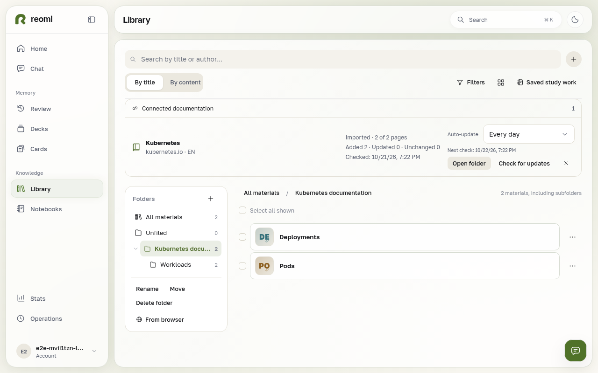
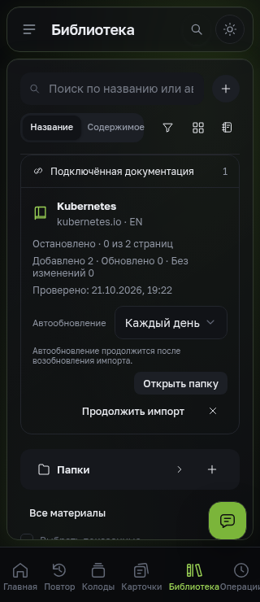

# Reviewed schedule controls

The deterministic documentation browser journey was rerun after the final style changes. It uses real authenticated library/folder/source routes and fixtures for remote discovery and schedule responses. API tests cover the actual schedule worker. These images do not claim a live Kubernetes import or a real installed iOS PWA.

- [Browser, light desktop](collection-desktop-light.png): keyboard selection of Every day, next check and persisted run summary.
- [Active import](progress-desktop-light.png): schedule alongside independent Stop control.
- [Standalone, dark Russian desktop](standalone-desktop-dark-ru.png): stopped import keeps scheduling paused until Resume.
- [Standalone, dark Russian at 320 px](standalone-small-dark-ru.png): readable controls with no horizontal overflow.

All four images were visually reviewed. The journey also checks reading the saved source and disconnecting without deleting materials. Display-mode standalone is emulated in Chromium.

