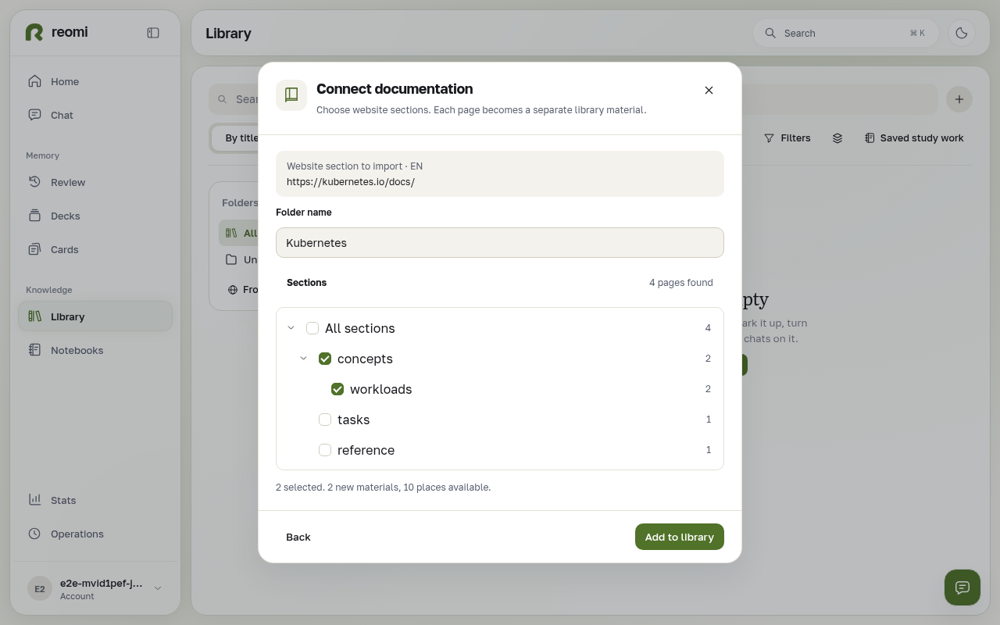
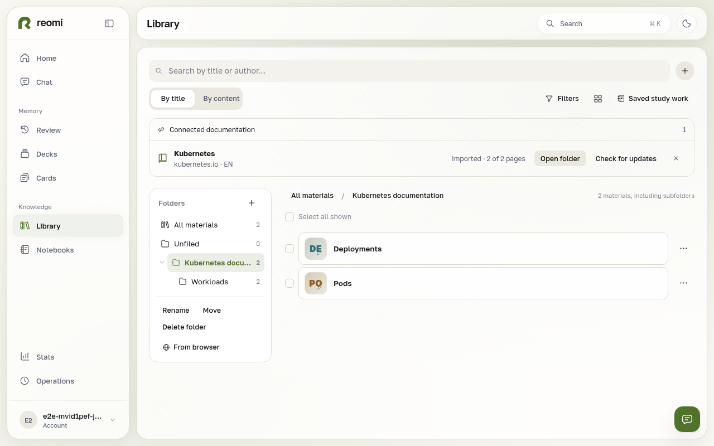
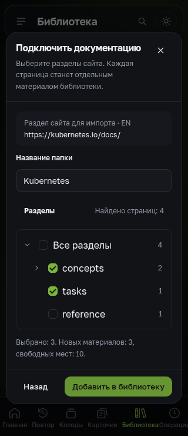

# Reviewed documentation import screens

The browser journey uses deterministic documentation-discovery/control responses and real signed-in library/folder/source endpoints. The API integration suite separately runs the actual persistent importer with guarded HTTP fixtures. These screenshots do not claim a live Kubernetes crawl.

All views were opened and visually inspected. The journey checks page width, hierarchical keyboard selection, compact folder navigation, ordinary source reading, update/stop controls, and content-preserving disconnect.

| Surface | Evidence |
| --- | --- |
| Browser, light, desktop section preview | [Preview](preview-desktop-light.png) |
| Browser, light, mobile preview | [390 px](preview-mobile-light.png) |
| Browser, light, connected collection and compact source list | [Collection](collection-desktop-light.png) |
| Browser, light, active synchronization | [Progress](progress-desktop-light.png) |
| Standalone, dark, Russian, desktop | [Collection](standalone-desktop-dark-ru.png) |
| Standalone, dark, Russian, 320 px | [Collection](standalone-small-dark-ru.png) |
| Standalone, dark, Russian, 320 px import dialog | [Preview](preview-standalone-small-dark-ru.png) |

